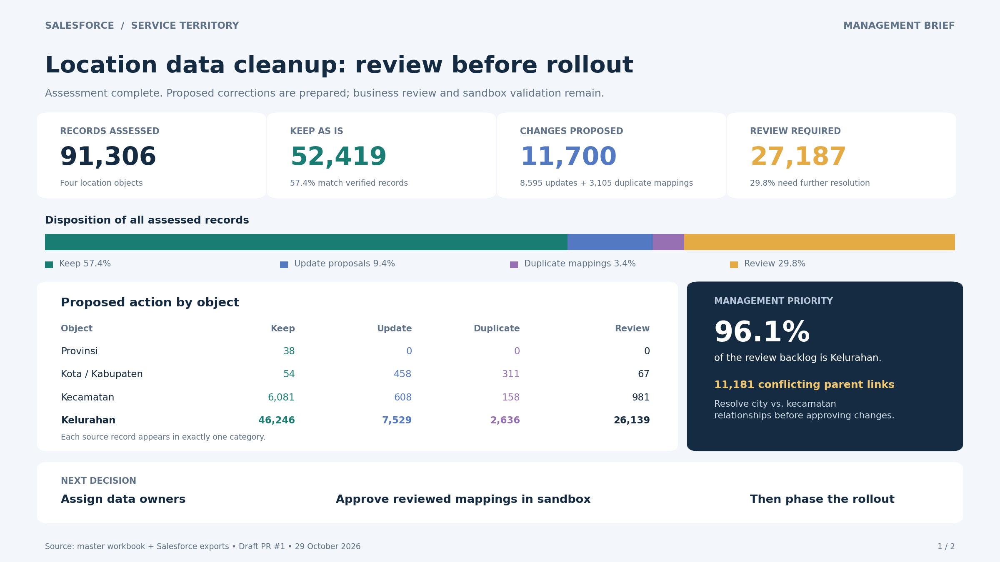
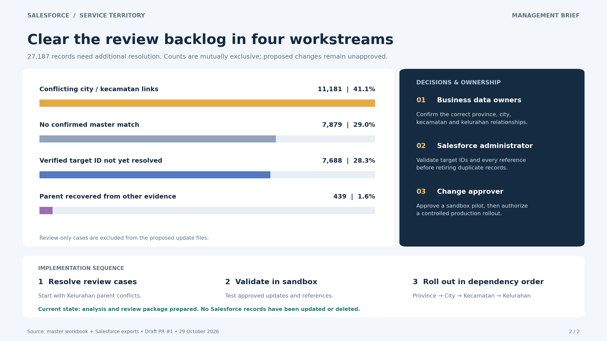

# Management summary: Salesforce location data cleansing

Two slides for management review, based on the analyzed export snapshot of 29 October 2026.

- **PDF:** `Salesforce_cleansing_management_summary.pdf` — two pages, suitable for sharing or printing.
- **PowerPoint:** `Salesforce_cleansing_management_summary.pptx` — two presentation slides; the charts are rendered images rather than editable shapes.
- **Images:** `Management_summary_1.png` and `Management_summary_2.png` — suitable for email or insertion into other presentations.

The 91,306 source records are split into mutually exclusive groups: 52,419 keep; 8,595 proposed updates; 3,105 proposed duplicate mappings; and 27,187 requiring review. Review consists of 11,181 conflicting city/kecamatan links, 7,879 with no confirmed master match, 7,688 without a safely resolved target ID, and 439 recovered-parent cases.

Proposals are not approved uploads. No Salesforce records have been changed. Review counts describe the full hierarchy assessment and include issues outside the original gap-analysis list. Kelurahan contributes 26,139 records, or 96.1% of the review backlog. Named ownership and implementation steps are recommendations, not assigned tasks or approved commitments.
